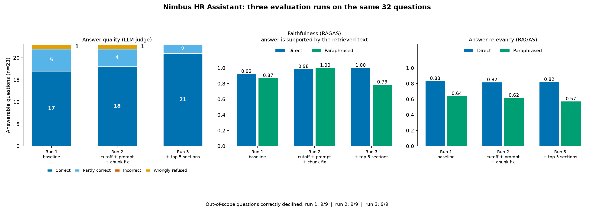

# Nimbus HR Assistant

A Retrieval-Augmented Generation (RAG) web app that answers employee questions from a company handbook, cites the handbook sections it used, and declines when the handbook doesn't cover the question.

Built end to end: document ingestion, vector search, grounded answer generation, JWT authentication, saved chat history, an admin screen for uploading new handbook versions, and a measured evaluation of answer quality.

> Status: running locally. Deployment is planned. Evaluation numbers below are from a 32-question set (see [Evaluation](#evaluation)).


## What it does

- **Ask in plain language.** "Can I claim a gym membership?" is answered from the wellness-allowance section, with source chips showing which sections were used.
- **Says "I don't have that information"** instead of guessing when the handbook is silent (for example, pet-friendly benefits).
- **Accounts and roles.** Employees can chat; admins can also upload and manage handbook documents.
- **Saved conversations.** Each user has their own history, and one user cannot open another's conversations.
- **Admin upload.** Uploading a new handbook version re-chunks, re-embeds and re-indexes it; answers reflect the change straight away.

## Architecture

```
React (Vite, TypeScript, Tailwind, shadcn/ui)
        |  JWT (access + refresh)
        v
Django + DRF  ------------------------>  FastAPI RAG service
 users, auth, chat history,   forwards     /ingest  (admin only)
 documents, admin APIs        the token    /query   (any signed-in user)
        |                                       |
        v                                       v
              PostgreSQL + pgvector (HNSW, cosine)
```

- **Django** owns the schema, users, JWT login (SimpleJWT), conversations and messages. It proxies questions to the RAG service and stores the replies.
- **FastAPI** owns the RAG pipeline. It verifies the same JWT independently, so the RAG service is protected even if it is called directly.
- **Retrieval:** the handbook is split into one chunk per `###` section, embedded with `all-MiniLM-L6-v2` (384 dimensions) and stored in Postgres with a pgvector HNSW index. A question retrieves the most similar sections by cosine similarity, and a similarity cutoff rejects questions unrelated to the handbook before the LLM is called.
- **Generation:** the retrieved sections go into a grounded prompt to `openai/gpt-oss-20b` on Groq, which is told to answer only from them and to say so when the answer isn't there.

## Tech stack

| Layer | Tools |
|---|---|
| Frontend | React, Vite, TypeScript, Tailwind CSS v4, shadcn/ui |
| Backend | Django, Django REST Framework, SimpleJWT, django-cors-headers |
| RAG service | FastAPI, sentence-transformers, PyJWT |
| Database | PostgreSQL with pgvector |
| LLM | Groq (`openai/gpt-oss-20b`), free tier |
| Evaluation | RAGAS, LLM-as-judge (`openai/gpt-oss-120b`), matplotlib |

Everything runs on free tiers.

## Security

- Short-lived access tokens (15 min) with refresh tokens (7 days); the client refreshes on 401.
- Admin-only endpoints are enforced on the server (Django returns 403, the RAG service returns 401/403). Hiding the admin button in the UI is only a convenience.
- Conversations are scoped to their owner; other users get a 404.

## Evaluation

I built a small evaluation harness and used it to change the system, not just to report on it.

**Test set:** 32 questions written against the handbook: 16 direct, 7 paraphrased (different wording from the handbook), and 9 out-of-scope (the handbook doesn't cover them), each with expected sections and a reference answer.

**Retrieval (is the right section found?)**

| Question type | Right section in top 3 |
|---|---|
| Direct (n=16) | 100% |
| Paraphrased (n=7) | 86% at top 3; 100% at top 4 |

**End to end: three runs on the same 32 questions**



| Measure | Run 1 (baseline) | Run 2 (cutoff, prompt, chunk fix) | Run 3 (final, top 5 sections) |
|---|---|---|---|
| Answerable questions fully correct (of 23, LLM judge) | 17 | 18 | **21** |
| Partly correct | 5 | 4 | 2 |
| Answered incorrectly | 0 | 0 | 0 |
| Wrongly refused | 1 | 1 | **0** |
| Out-of-scope questions correctly declined (of 9) | 9 | 9 | 9 |
| RAGAS faithfulness, direct / paraphrased | 0.92 / 0.87 | 0.98 / 1.00 | 1.00 / 0.79 |
| RAGAS answer relevancy, direct / paraphrased | 0.83 / 0.64 | 0.82 / 0.62 | 0.82 / 0.57 |

The two remaining "partly correct" answers are correct but add extra detail beyond the handbook's wording.

**What the evaluation changed**
- **Chunking bug found and fixed.** The last chunk of each section was absorbing the next `##` heading, which polluted six chunks.
- **Similarity cutoff tuned** by sweeping thresholds and measuring false refusals against out-of-scope leaks.
- **Prompt tightened**, which raised direct-question faithfulness from 0.92 to 0.98 (and to 1.00 in the final run).
- **Cross-encoder reranker tested and not adopted.** It gave no meaningful gain on this handbook (top-1 accuracy 84% to 84%) and separated answerable from out-of-scope questions worse.
- **The one wrongly refused question was traced to retrieval, not the model:** a freelance-work question whose answer section (conflict of interest) ranked 4th, so it never reached the prompt. Retrieving the top 5 sections instead of 3 fixed it without letting any out-of-scope question through (still 9 of 9 declined).

**Caveats, stated plainly**
- The set is small (32 questions), so differences of one question are not significant.
- The judge is an LLM, and so is RAGAS; both have blind spots. I reviewed every answer flagged for low faithfulness by hand. In the final run, the paraphrased faithfulness of 0.79 comes from three answers scored 0.50: one was a genuine minor overstatement by the model (it called the anonymous hotline "the designated channel" when the handbook lists it as one of three options), one was the judge being too literal (it rejected a correct answer because the handbook doesn't name the weekday the user asked about), and one scored 1.0 when I re-checked the same answer, so the metric is unstable. The paraphrased faithfulness drop from run 2 is within that noise on 7 questions.
- Three changes (chunking, cutoff, prompt) were made together in run 2, so their individual effects are not separated.
- Answer relevancy is the least informative metric here: it drifted slightly down on paraphrased questions, and I did not tune for it.

Evaluation scripts are in `evaluation/`.

## Run it locally

Prerequisites: Python 3.11+, Node 18+, PostgreSQL with the `pgvector` extension, a free [Groq API key](https://console.groq.com).

```bash
# 1. Backend (Django)
cd backend
python -m venv .venv && source .venv/bin/activate
pip install -r requirements.txt
python manage.py migrate
python manage.py createsuperuser        # this account becomes the admin
python manage.py runserver              # http://127.0.0.1:8000

# 2. RAG service (FastAPI)
cd rag-service
python -m venv .venv && source .venv/bin/activate
pip install -r requirements.txt
# create .env with:  GROQ_API_KEY=...   DJANGO_SECRET_KEY=<same as backend/config/settings.py>
uvicorn main:app --port 8001            # use the port Django's RAG_SERVICE_URL points to

# 3. Frontend
cd frontend
npm install
npm run dev                             # http://localhost:5173
```

`DJANGO_SECRET_KEY` in the RAG service must match Django's `SECRET_KEY`, because the RAG service verifies the tokens Django signs.

Sign in as the admin, open **Manage documents**, and upload the handbook (a sample is included) to build the index.

## Project layout

```
backend/        Django project: auth, documents, conversations
rag-service/    FastAPI: chunking, embeddings, retrieval, generation
frontend/       React app
evaluation/     eval set, scripts, results
poc/            the original single-file proof of concept
```

## Roadmap

- UI polish and mobile layout
- Google sign-in
- Deployment to AWS
- More paraphrased test questions, and a stronger embedding-model comparison

## About

Built by Sruthi Akella, dual-degree student in Chemical Engineering and Chemistry at BITS Pilani, Hyderabad Campus, as a hands-on way to learn generative AI by building a complete system.
