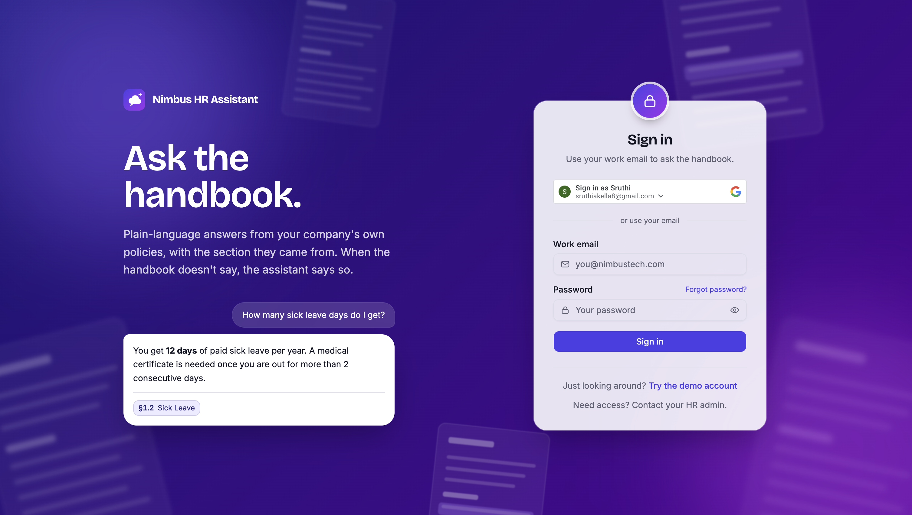
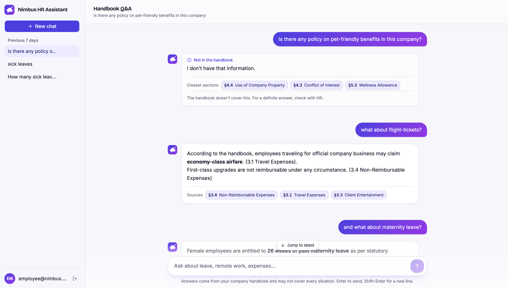
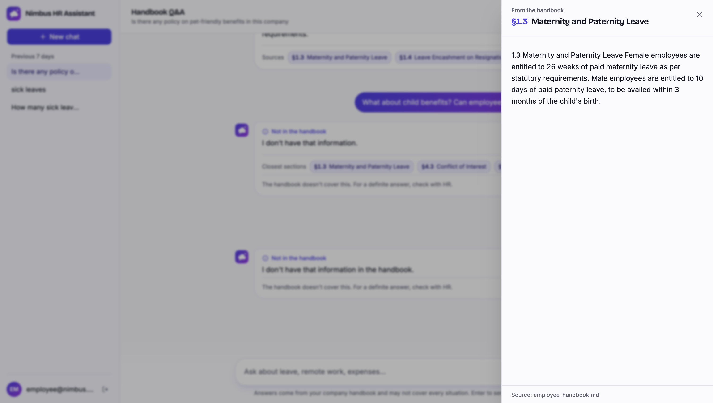
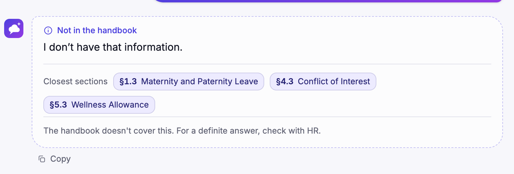
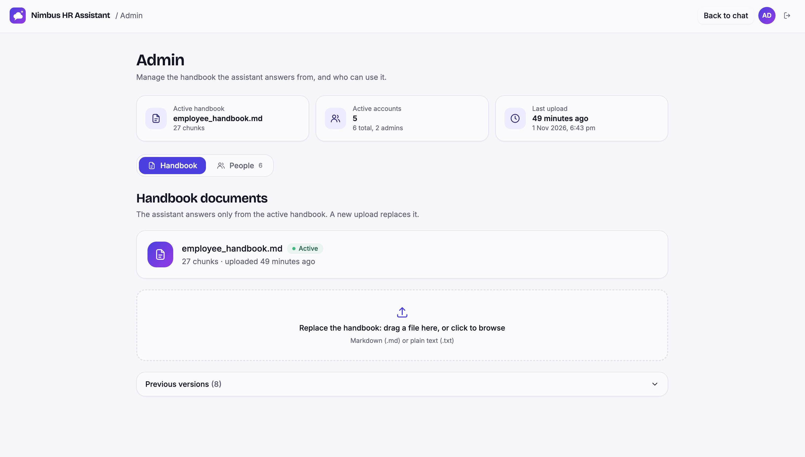
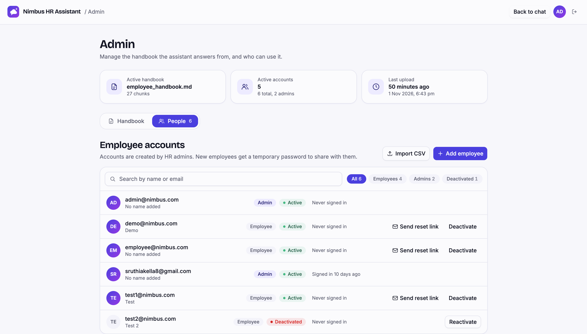
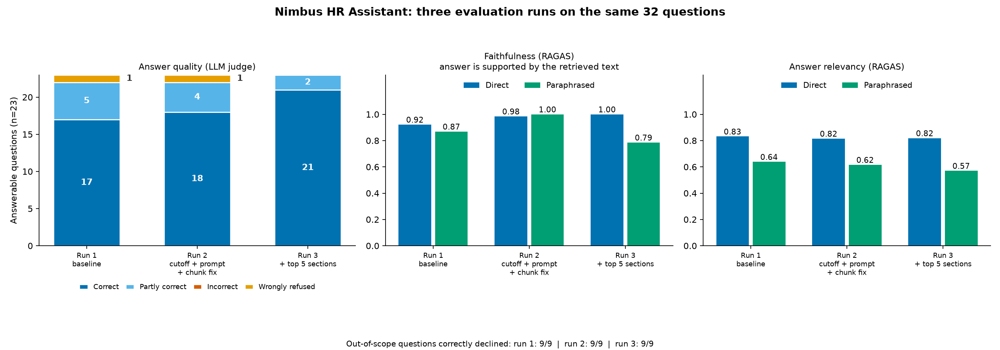

# Nimbus HR Assistant

A Retrieval-Augmented Generation (RAG) web app that answers employee questions from a company handbook, cites the handbook sections it used, and declines when the handbook doesn't cover the question.

Built end to end: document ingestion, vector search, grounded answer generation, JWT authentication with admin-managed accounts, saved chat history, an admin screen for handbook versions and employee accounts, and a measured evaluation of answer quality.

> Status: running locally. Deployment to AWS is next. Evaluation numbers below are from a 32-question set (see [Evaluation](#evaluation)), run on one handbook.

| | |
|---|---|
|  |  |
| Sign in, with Google or email | An answer with the handbook sections it came from |
|  |  |
| Click a section to read the handbook text behind the answer | When the handbook is silent, it says so instead of guessing |
|  |  |
| Admin: the active handbook and its versions | Admin: employee accounts, password resets, CSV import |

## What it does

- **Ask in plain language.** "Can I claim a gym membership?" is answered from the wellness-allowance section, with source chips showing which sections were used.
- **Check the source.** Clicking a chip opens the exact handbook text the answer was drawn from.
- **Says "I don't have that information"** instead of guessing when the handbook is silent (for example, pet-friendly benefits), and shows the closest sections it did find.
- **Accounts and roles.** Employees can chat; admins can also manage handbook documents and employee accounts.
- **Saved conversations.** Each user has their own history, grouped by date, and can rename or delete chats. One user cannot open another's conversations.
- **Admin tools.** Upload a new handbook version (it is re-chunked, re-embedded and re-indexed, and answers reflect the change straight away); create employees one at a time or from a CSV; deactivate and reactivate accounts; send an employee a password reset link.

## Architecture

```
React (Vite, TypeScript, Tailwind, shadcn/ui)
        |  JWT (access + refresh)
        v
Django + DRF  ------------------------>  FastAPI RAG service
 users, auth, chat history,   forwards     /ingest  (admin only)
 documents, admin APIs        the token    /query   (any signed-in user)
        |                                       |
        v                                       v
              PostgreSQL + pgvector (HNSW, cosine)
```

- **Django** owns the schema, users, JWT login (SimpleJWT), conversations and messages. It proxies questions to the RAG service, stores the replies, and serves the section text behind each source chip from the same chunk table.
- **FastAPI** owns the RAG pipeline. It verifies the same JWT independently, so the RAG service is protected even if it is called directly.
- **Retrieval:** the handbook is split into one chunk per `###` section, embedded with `all-MiniLM-L6-v2` (384 dimensions) and stored in Postgres with a pgvector HNSW index. A question retrieves the top 5 most similar sections by cosine similarity, and a similarity cutoff rejects questions unrelated to the handbook before the LLM is called.
- **Generation:** the retrieved sections go into a grounded prompt to `openai/gpt-oss-20b` on Groq (temperature 0), which is told to answer only from them and to say so when the answer isn't there.

## Tech stack

| Layer | Tools |
|---|---|
| Frontend | React, Vite, TypeScript, Tailwind CSS v4, shadcn/ui |
| Backend | Django, Django REST Framework, SimpleJWT, django-cors-headers, google-auth |
| RAG service | FastAPI, sentence-transformers, PyJWT |
| Database | PostgreSQL with pgvector |
| LLM | Groq (`openai/gpt-oss-20b`), free tier |
| Evaluation | RAGAS, LLM-as-judge (`openai/gpt-oss-120b`), matplotlib |

Everything runs on free tiers.

## Authentication and security

Accounts are created by admins, not by public sign-up, because this is an internal tool.

- **Sign-in:** email and password, or Google. Google sign-in works only for accounts an admin has already created: the Google ID token is verified on the server and matched by verified email, and unknown emails are rejected.
- **New accounts:** an admin creates an employee (one at a time or from a CSV) and gets a random temporary password, shown once.
- **Password reset:** a one-time link emailed to the user. The token is tied to the user's current password and last login, so it stops working once used, and it expires after 1 hour. The "forgot password" endpoint replies the same way whether or not the email exists, so it can't be used to find out who has an account, and it is rate limited to 5 requests per hour per IP. New passwords are checked against Django's password rules.
- **Admins** can send an employee a reset link, but admin accounts are never created or changed through the API (use `manage.py createsuperuser`), so a compromised admin session can't create more admins.
- **Tokens:** short-lived access tokens (15 min) with refresh tokens (7 days); the client refreshes on 401.
- **Server-side checks:** admin-only endpoints are enforced on the server (Django returns 403, the RAG service returns 401/403). Hiding the admin button in the UI is only a convenience.
- **Data scoping:** conversations belong to their owner; other users get a 404.

## Evaluation

I built a small evaluation harness and used it to change the system, not just to report on it.

**Test set:** 32 questions written against the handbook: 16 direct, 7 paraphrased (different wording from the handbook), and 9 out-of-scope (the handbook doesn't cover them), each with expected sections and a reference answer. 23 of the 32 are answerable.

**Retrieval (is the right section found?)**

| Question type | Right section in top 3 |
|---|---|
| Direct (n=16) | 100% |
| Paraphrased (n=7) | 86% at top 3; 100% at top 4 |

**End to end: three runs on the same 32 questions**



| Measure | Run 1 (baseline) | Run 2 (cutoff, prompt, chunk fix) | Run 3 (final, top 5 sections) |
|---|---|---|---|
| Answerable questions fully correct (of 23, LLM judge) | 17 | 18 | **21** |
| Partly correct | 5 | 4 | 2 |
| Answered incorrectly | 0 | 0 | 0 |
| Wrongly refused | 1 | 1 | **0** |
| Out-of-scope questions correctly declined (of 9) | 9 | 9 | 9 |
| RAGAS faithfulness, direct / paraphrased | 0.92 / 0.87 | 0.98 / 1.00 | 1.00 / 0.79 |
| RAGAS answer relevancy, direct / paraphrased | 0.83 / 0.64 | 0.82 / 0.62 | 0.82 / 0.57 |

The two remaining "partly correct" answers are correct but add extra detail beyond the handbook's wording.

**What the evaluation changed**
- **Chunking bug found and fixed.** The last chunk of each section was absorbing the next `##` heading, which polluted six chunks.
- **Similarity cutoff tuned** by sweeping thresholds and measuring false refusals against out-of-scope leaks.
- **Prompt tightened**, which raised direct-question faithfulness from 0.92 to 0.98 (and to 1.00 in the final run).
- **Cross-encoder reranker tested and not adopted.** It gave no meaningful gain on this handbook (top-1 accuracy 84% to 84%) and separated answerable from out-of-scope questions worse.
- **The one wrongly refused question was traced to retrieval, not the model:** a freelance-work question whose answer section (conflict of interest) ranked 4th, so it never reached the prompt. Retrieving the top 5 sections instead of 3 fixed it without letting any out-of-scope question through (still 9 of 9 declined).

**Caveats, stated plainly**
- The set is small (32 questions), so differences of one question are not significant.
- It covers one handbook that is clean, short and written in the `###` section format the chunker expects. These numbers say how this system did on this document; they are not a promise for other handbooks (see [Limitations](#limitations)).
- The judge is an LLM, and so is RAGAS; both have blind spots. I reviewed every answer flagged for low faithfulness by hand. In the final run, the paraphrased faithfulness of 0.79 comes from three answers scored 0.50: one was a genuine minor overstatement by the model (it called the anonymous hotline "the designated channel" when the handbook lists it as one of three options), one was the judge being too literal (it rejected a correct answer because the handbook doesn't name the weekday the user asked about), and one scored 1.0 when I re-checked the same answer, so the metric is unstable. The paraphrased faithfulness drop from run 2 is within that noise on 7 questions.
- Three changes (chunking, cutoff, prompt) were made together in run 2, so their individual effects are not separated.
- Answer relevancy is the least informative metric here: it drifted slightly down on paraphrased questions, and I did not tune for it.

Evaluation scripts are in `evaluation/`.

## Run it locally

Prerequisites: Python 3.11+, Node 18+, PostgreSQL with the `pgvector` extension, a free [Groq API key](https://console.groq.com).

```bash
# 1. Backend (Django)
cd backend
python -m venv .venv && source .venv/bin/activate
pip install -r requirements.txt
python manage.py migrate
python manage.py createsuperuser        # this account becomes the admin
python manage.py runserver              # http://127.0.0.1:8000

# 2. RAG service (FastAPI)
cd rag-service
python -m venv .venv && source .venv/bin/activate
pip install -r requirements.txt
# create .env with:  GROQ_API_KEY=...   DJANGO_SECRET_KEY=<same as backend/config/settings.py>
uvicorn main:app --port 8001            # must match Django's RAG_SERVICE_URL

# 3. Frontend
cd frontend
npm install
npm run dev                             # http://localhost:5173
```

`DJANGO_SECRET_KEY` in the RAG service must match Django's `SECRET_KEY`, because the RAG service verifies the tokens Django signs.

Sign in as the admin, open **Manage documents and users**, upload the handbook (a Markdown or text file; a sample is included) to build the index, then create employee accounts from the **People** tab.

**Optional settings**
- **Google sign-in:** create an OAuth client in Google Cloud Console, set `GOOGLE_CLIENT_ID` for Django and `VITE_GOOGLE_CLIENT_ID` in `frontend/.env`. The button only appears when the frontend variable is set.
- **Password reset emails:** in development, Django prints emails (and the reset link) to its terminal. For real delivery, set the `EMAIL_BACKEND` and SMTP settings and `FRONTEND_URL`.

## Project layout

```
backend/        Django project: auth, documents, conversations, admin APIs
rag-service/    FastAPI: chunking, embeddings, retrieval, generation
frontend/       React app
evaluation/     eval set, scripts, results
docs/           screenshots and evaluation charts used in this README
poc/            the original single-file proof of concept
```

## Limitations

- **Handbook format.** Upload accepts Markdown or plain text, and the chunker splits on `###` section headings. Real handbooks are usually PDFs or Word files with inconsistent headings, which this version does not read.
- **One handbook evaluated.** Quality on other documents is untested.
- **Free-tier limits.** Groq's free allowance caps how many questions can be answered per day, so a public demo needs a lower per-user rate limit.
- **Small evaluation set.** 32 questions, with an LLM as judge.

## Roadmap

- Deployment to AWS
- PDF and Word ingestion, with a size-based chunker for files that have no clear headings
- Re-run the evaluation on a second, real company handbook (about 15 new questions) to measure how well the system generalizes
- Streaming answers
- More paraphrased test questions, and a stronger embedding-model comparison

## About

Built by Sruthi Akella, dual-degree student in Chemical Engineering and Chemistry at BITS Pilani, Hyderabad Campus, as a hands-on way to learn generative AI by building a complete system.
